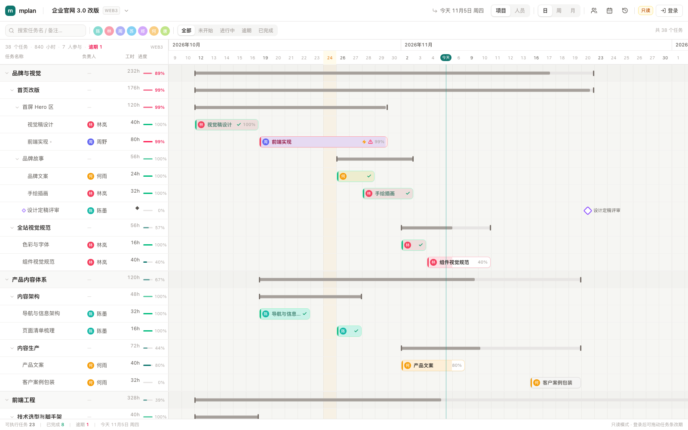
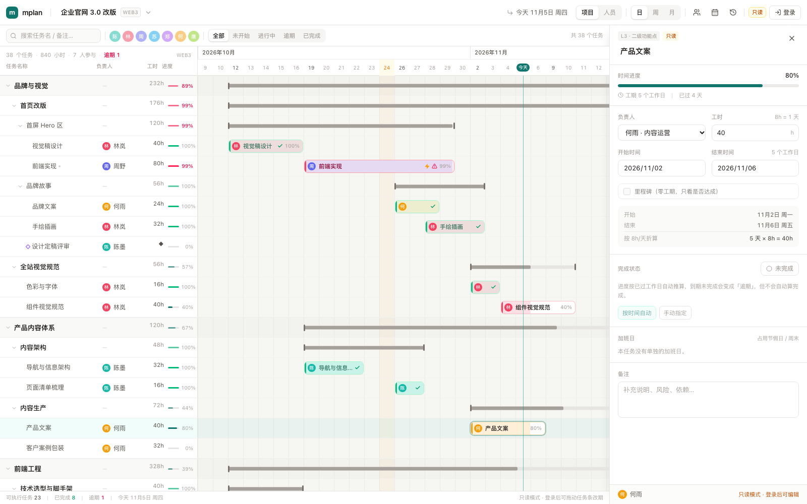
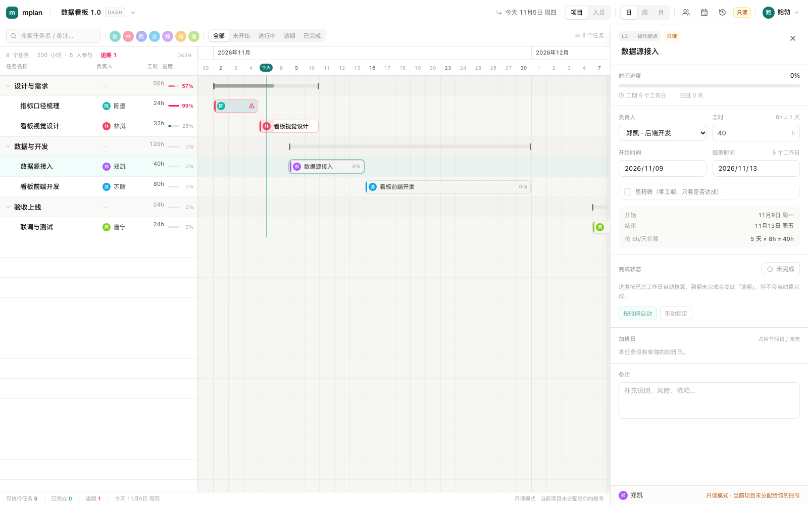
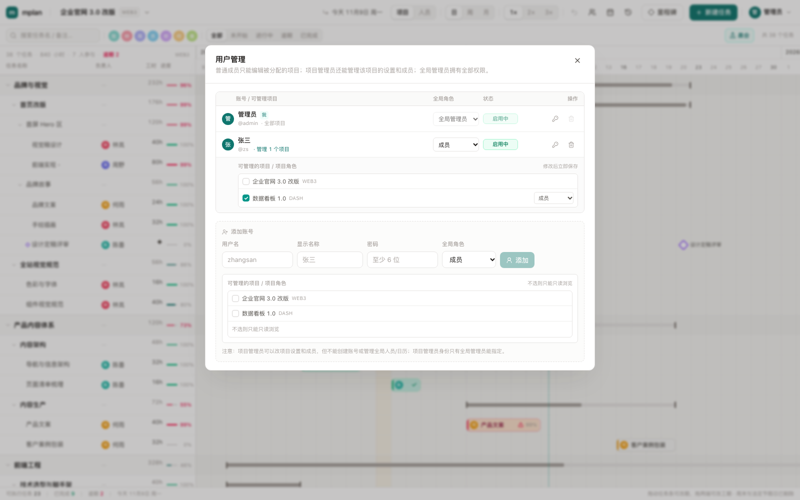

# mplan 登录与权限

> 权限分四层：**匿名只读；普通成员编辑被分配的项目；项目管理员额外管理项目设置和成员；全局管理员管理全部项目、账号、人员、日历。**

| 身份 | 只读浏览 | 编辑项目 | 项目设置 / 成员 | 账号 / 人员 / 日历 | 项目增删 |
|---|---|---|---|---|---|
| 未登录 | ✅ 全部项目 | ❌ | ❌ | ❌ | ❌ |
| 成员 `member` | ✅ 全部项目 | ✅ 仅 `projectIds` 里的项目 | ❌ | ❌ | ❌ |
| 项目管理员 | ✅ 全部项目 | ✅ 被指定为管理员的项目 | ✅ 仅这些项目 | ❌ | ❌ |
| 全局管理员 `admin` | ✅ 全部项目 | ✅ 全部项目 | ✅ 全部项目 | ✅ | ✅ |

只读不需要登录，直接打开就能看。登录只是获得「修改被授权部分」的能力。

---

## 1. 快速体验

| 场景 | 操作 |
|---|---|
| 只读浏览 | 直接打开 http://localhost:5173 ，右上角显示「只读」 |
| 登录 | 点右上角「登录」，输入账号密码 |
| 首次部署 | 数据库里一个账号都没有时，登录框会变成「初始化管理员」，创建的第一个账号自动成为管理员 |
| 本地种子默认账号 | `admin` / `mplan123`（可用环境变量覆盖，见 §5） |
| 生产初始账号 | 发布脚本调用 `admin:create` 创建，用户名/密码来自本机 `.deploy.env`；生产**不执行 seed** |
| 管理账号 / 分配项目 | 全局管理员点右上角头像 →「用户管理」→ 勾选项目，并给每个项目选「成员 / 项目管理员」 |
| 项目设置 / 成员 | 项目管理员或全局管理员打开项目菜单 →「项目设置 / 成员」 |

> **首次登录后请立刻重置密码**：头像菜单 → 用户管理 → 自己那一行的钥匙图标。
> 重置自己的密码会强制重新登录一次。生产环境的初始密码只存在部署机的 `.deploy.env` 里。

### 只读界面



只读模式下：右上角出现「只读 + 登录」，新建任务 / 里程碑 / 撤销 / 新建项目 / 导入等写入口全部隐藏；任务抽屉和人员、日历、变更日志仍可打开，但所有编辑控件禁用。



### 登录了，但当前项目没分配给该账号

成员登录后仍然可以浏览全部项目；切到没被分配的项目时，页面回到只读态，顶部显示「只读」，状态栏提示「当前项目未分配给你的账号」。



### 用户管理 / 项目分配



---

## 2. 会话与权限是怎么做的

```
浏览器  ── POST /api/auth/login ──▶  API
        ◀── Set-Cookie: mplan_session=<随机 token>; HttpOnly; SameSite=Lax; Path=/ ──

后续请求 ── Cookie: mplan_session=<token> ──▶ API
                                          ├─ 库里查 sha256(token) → sessions
                                          ├─ 校验 expires_at / users.active
                                          ├─ 普通成员再查 project_members.project_id[]
                                          └─ 挂到 request.currentUser（含 projectIds）
```

- **token 只存在浏览器**，数据库只存 `sha256(token)`（`sessions.token_hash`），库被读走也不能直接冒充登录。
- Cookie 是 `HttpOnly` + `SameSite=Lax`，前端 JS 读不到；写接口为 JSON，再叠加 `Origin` 白名单挡 CSRF。
- 密码用 Node 内置 `scrypt`（随机 16 字节 salt，64 字节派生），存 `scrypt$salt$hash`，校验用 `timingSafeEqual`。
- 会话默认 7 天（`SESSION_DAYS`），每次登录顺手清理过期会话；停用账号 / 重置密码会删除该账号的所有会话，强制下线。
- 登录失败按 IP 限流：10 分钟内 8 次失败返回 429（内存计数，单机部署够用）。
- **项目授权实时生效**：每次请求都从 `project_members` 重新读，管理员改了某人的项目后，对方下一次写请求立刻按新权限判断，不用重新登录。

---

## 3. 后端拦截点（两层）

### 第一层：登录拦截

`apps/api/src/lib/auth.ts` 的 `attachAuth()` 在所有路由之前挂了一个 `onRequest` 钩子：

```ts
// 每个请求先解析会话
req.currentUser = await resolveSession(readSessionToken(req));

// 只拦截写操作；GET / HEAD / OPTIONS 一律放行（只读不需要登录）
if (!UNSAFE_METHODS.has(req.method)) return;

// 登录、首次初始化、退出必须允许匿名
if (PUBLIC_WRITE_PATHS.has(pathOf(req))) return;

if (!req.currentUser) throw httpError('请先登录再修改', 401);
```

### 第二层：项目 / 全局权限

登录还不够，具体资源再判一次：

| 资源 | 判断 | 说明 |
|---|---|---|
| 任务的新建 / 修改 / 删除 / 顺延 / 加班日 | `requireProjectAccess(req, projectId)` | 全局管理员或该项目在 `projectIds` 里 |
| CSV 导入到已有项目 | `requireProjectAccess(req, projectId)` | 同上 |
| CSV 导入并新建项目 | `requireAdmin(req)` | 建项目属于全局操作 |
| 项目修改（名称 / 编号 / 日期 / 备注） | `requireProjectAdmin(req, projectId)` | 全局管理员或该项目的项目管理员 |
| 项目成员列表 / 添加 / 移除 | `requireProjectAdmin(req, projectId)` | 项目管理员可添加/移除普通成员，不能移除其他项目管理员 |
| 项目新建 / 删除 | `requireAdmin(req)` | 项目本身是全局资源 |
| 人员增删改 / 个人加班请假 | `requireAdmin(req)` | 人员跨项目共享 |
| 公司日历 | `requireAdmin(req)` | 全局设置 |
| 账号管理 | `requireAdmin(req)` | |

所以：

| 方法 | 是否需要登录 | 说明 |
|---|---|---|
| GET / HEAD | ❌ | 全部只读接口公开 |
| POST / PUT / PATCH / DELETE | ✅ | 除 `/api/auth/login`、`/api/auth/setup`、`/api/auth/logout` |
| 任务 / 导入到已有项目 | ✅ + 项目权限 | 管理员或项目成员 |
| 项目修改 / 项目成员 | ✅ + 项目管理员 | 全局管理员或该项目的项目管理员 |
| 项目增删 / 人员 / 日历 / 新建项目导入 / 账号 | ✅ + 全局管理员 | 路由内部 `requireAdmin()` |

**这是唯一的权限真相**：前端隐藏按钮只是体验，直接 `curl` 打写接口同样会 401 / 403。

---

## 4. 接口

| 方法 | 路径 | 权限 | 说明 |
|---|---|---|---|
| GET | `/api/auth/me` | 匿名 | 当前用户 + `projectIds` / `projectAdminIds` + `needsSetup` |
| POST | `/api/auth/setup` | 匿名，仅当 0 账号 | 创建第一个管理员并登录 |
| POST | `/api/auth/login` | 匿名 | 登录，下发会话 Cookie |
| POST | `/api/auth/logout` | 匿名 | 删除会话 + 清 Cookie |
| GET | `/api/auth/users` | 全局管理员 | 账号列表（含 `projectIds` / `projectAdminIds`，不含密码哈希） |
| POST | `/api/auth/users` | 全局管理员 | 新建账号，可带 `projectIds` / `projectAdminIds` |
| PATCH | `/api/auth/users/:id` | 全局管理员 | 改名 / 改角色 / 停用 / 重置密码 / 替换项目与项目管理员 |
| GET | `/api/projects/:id/members` | 项目管理员 | 项目成员 + 可添加的账号候选 |
| POST | `/api/projects/:id/members` | 项目管理员 | 添加普通成员（不能授予项目管理员） |
| DELETE | `/api/projects/:id/members/:userId` | 项目管理员 | 移除普通成员；项目管理员不能移除其他项目管理员 |
| PATCH | `/api/projects/:id` | 项目管理员 | 修改项目名称 / 编号 / 日期 / 备注 |
| DELETE | `/api/auth/users/:id` | 管理员 | 删除账号（不能删自己、不能删最后一个管理员） |

`GET /api/bootstrap` 会额外返回：

```json
{
  "auth": {
    "user": {
      "id": "…",
      "username": "bob",
      "displayName": "鲍勃",
      "role": "member",
      "projectIds": ["<项目 id>"],
      "projectAdminIds": ["<项目 id>"]
    },
    "canEdit": true,
    "isAdmin": false,
    "projectIds": ["<项目 id>"],
    "projectAdminIds": ["<项目 id>"],
    "needsSetup": false
  }
}
```

前端据此算三个开关：

```ts
canEditCurrent  = user.role === 'admin' || user.projectIds.includes(detail.project.id)
canAdminCurrent = user.role === 'admin' || user.projectAdminIds.includes(detail.project.id)
canEditGlobal   = user.role === 'admin'
```

`canEditCurrent` 控制甘特拖拽、任务抽屉、导入当前项目；`canAdminCurrent` 控制「项目设置 / 成员」入口；`canEditGlobal` 控制人员、日历、新建/删除项目、账号管理。**三者不要混用**。

---

## 5. 配置

`apps/api/.env`：

```bash
CORS_ORIGIN=http://localhost:5173,http://127.0.0.1:5173   # 写请求的 Origin 白名单（开发环境放行 localhost）
SESSION_DAYS=7                                            # 会话有效期
COOKIE_SECURE=0                                           # 走 HTTPS 时设为 1
```

种子数据默认账号可用环境变量覆盖（只在 `users` 表为空时生效）：

```bash
MPLAN_SEED_USER=admin
MPLAN_SEED_PASSWORD=mplan123
MPLAN_SEED_NAME=管理员
```

---

## 6. 代码位置

| 想改什么 | 去哪个文件 |
|---|---|
| 密码哈希 / 会话 / Cookie / 限流 / 登录拦截 / 项目权限判断 | `apps/api/src/lib/auth.ts` |
| 登录、初始化、用户管理与项目分配接口 | `apps/api/src/routes.auth.ts` |
| 项目修改、项目成员接口 | `apps/api/src/routes.ts` |
| 任务 / 项目 / 人员 / 日历的写接口权限调用 | `apps/api/src/routes.ts` |
| 表结构（`users` / `sessions` / `project_members`） | `apps/api/src/db/schema.ts` |
| 登录弹窗 / 用户管理与项目角色 | `apps/web/src/components/LoginModal.tsx`、`UsersModal.tsx` |
| 项目设置 / 成员弹窗 | `apps/web/src/components/ProjectSettingsModal.tsx` |
| 登录态、`canEdit` / `canEditGlobal`、写操作兜底 | `apps/web/src/store.ts`、`apps/web/src/api.ts` |
| 只读态 UI | `TopBar.tsx`（入口）、`Board.tsx`、`TaskDrawer.tsx`、`PeopleModal.tsx`、`CalendarModal.tsx` |
| 变更日志署名 | `apps/api/src/lib/log.ts`（取 `req.currentUser.displayName`） |

---

## 7. 安全边界与后续

已经有的：

- 密码哈希、HttpOnly 会话 Cookie、登录限流、Origin 校验
- 登录拦截 + 项目级写权限；项目授权实时生效
- 项目管理员只能管理被指定的项目；不能创建账号、人员、日历，也不能删除项目
- 只有全局管理员能任命项目管理员；项目管理员不能自我提权或移除其他项目管理员
- 全局资源（人员 / 日历 / 项目增删 / 账号）仅全局管理员
- 账号停用 / 改密强制下线
- 变更日志的操作人来自会话，前端伪造 `x-mplan-actor` 已失效（该头不再读取）

还没做 / 有意的取舍：

- **授权只到项目级**：普通成员能编辑整个项目的所有任务，不区分负责人。要做「只能改自己负责的任务」需要再加 `owner_id` 级校验。
- **升级兼容**：从旧版本升上来的 `member` 账号默认没有项目，会直接变成「登录但只读」，需要管理员在用户管理里分配项目（或改成管理员）。
- **没有 HTTPS**：自托管 http 部署时 `COOKIE_SECURE=0`；面向公网请挂反向代理 + 开 `COOKIE_SECURE=1`。
- **没有自助改密 / 找回密码**：成员只能找管理员在「用户管理」里重置；忘记管理员密码只能查库或重新执行 `pnpm db:seed`（表里有账号时 seed 不会覆盖）。自助改密已列入 [ROADMAP.md](ROADMAP.md) P1。
- **生产发布**：见 [DEPLOY.md](DEPLOY.md)；发布脚本不会执行 `db:seed`，会单独创建初始管理员。
- **没有审计登录事件**：只记录业务变更；要审计登录需另加表。
- **没有 SSO**：单机自托管够用；接企业 SSO 时替换 `routes.auth.ts` 的登录入口即可，会话和拦截逻辑不用动。

---

## 8. 验收命令

```bash
# 1. 未登录写接口 → 401
curl -s -o /dev/null -w '%{http_code}\n' -X POST localhost:8787/api/projects \
  -H 'content-type: application/json' -d '{"name":"x","startDate":"2026-11-05"}'

# 2. 管理员登录
curl -c /tmp/admin.txt -X POST localhost:8787/api/auth/login \
  -H 'content-type: application/json' -d '{"username":"admin","password":"mplan123"}'

# 3. 取项目 id（P1 / P2），建一个只分配 P1 的成员
curl -s localhost:8787/api/bootstrap | python3 -c 'import json,sys;print("\n".join(p["id"] for p in json.load(sys.stdin)["projects"]))'
curl -b /tmp/admin.txt -X POST localhost:8787/api/auth/users \
  -H 'content-type: application/json' \
  -d '{"username":"bob","password":"bob123","displayName":"鲍勃","role":"member","projectIds":["<P1>"]}'

# 4. 成员登录，写 P1 → 201，写 P2 → 403，建项目 → 403，读接口 → 200
curl -c /tmp/bob.txt -X POST localhost:8787/api/auth/login \
  -H 'content-type: application/json' -d '{"username":"bob","password":"bob123"}'
curl -b /tmp/bob.txt -X POST localhost:8787/api/projects/<P1>/tasks \
  -H 'content-type: application/json' -d '{"name":"bob 的任务","estimateHours":8}'
curl -b /tmp/bob.txt -X POST localhost:8787/api/projects/<P2>/tasks \
  -H 'content-type: application/json' -d '{"name":"越权","estimateHours":8}'
curl -b /tmp/bob.txt -X POST localhost:8787/api/projects \
  -H 'content-type: application/json' -d '{"name":"x","startDate":"2026-11-05"}'

# 5. 匿名读取 → 200（只读不需要登录）
curl -s -o /dev/null -w '%{http_code}\n' localhost:8787/api/bootstrap
```