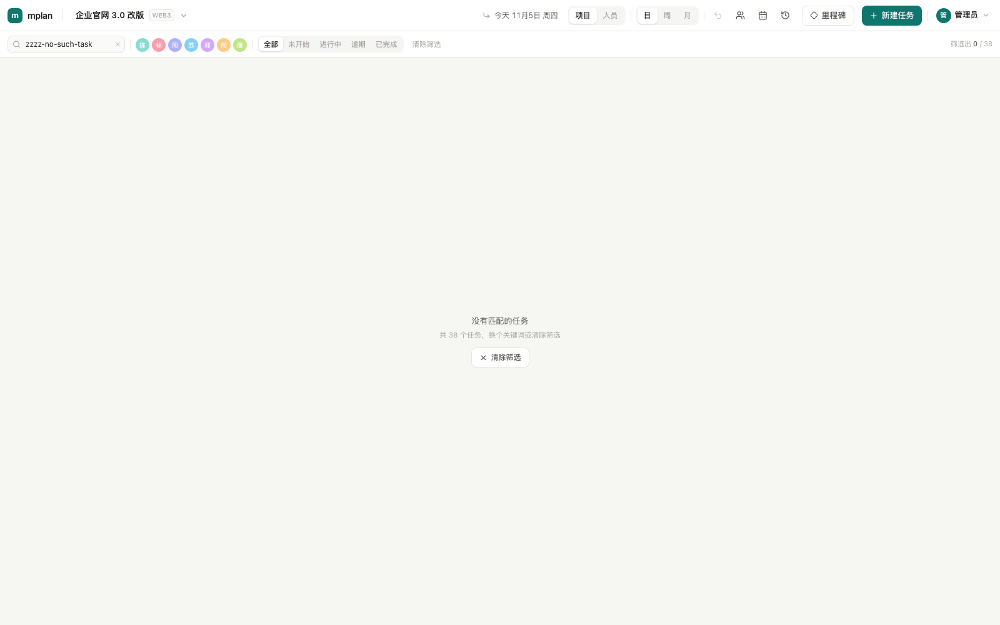

# mplan 设计说明

> 一份「精简版 OmniPlan」的取舍记录。核心原则：**能推算的绝不让人填，能提示的绝不阻断。**

---

## 一、六个需求里的三个隐藏冲突

### 1. 自动进度 × 手动完成

> 「10 天的任务做到第 5 天，没有异常就是 50%」
> 「甘特条上要能快捷设置完成状态」

第 10 天是不是自动 100%？任务不会因为时间到了就做完。所以把两件事拆开：

| 概念 | 规则 |
|---|---|
| **进度** | `已过工作日 ÷ 总工作日`，**封顶 99%**，纯推算 |
| **完成** | 只能人给。写入 `done_at`，进度 100%，不再随时间变化 |
| **逾期** | 今天 > 结束日 且未完成，进度条转红、状态为 overdue |
| **回退** | 「按时间自动 / 手动指定」随时切换 |

结论：**进度是推算值，完成是事实值，字段分开存**。数据库里不存 `progress`，避免「时间变了进度没刷新」的脏数据。

### 2. 工时 × 日期

工时和起止日期是同一个自由度的两种表达，各存各的必然打架。

```
工期(工作日) = ceil(工时 ÷ (8 × 人数))
```

- 改工时 → 结束日重新排，跳过非工作日
- 改结束日（或拖右边缘）→ 工时反算 `= 工期 × 8 × 人数`
- 拖整条 → 工时不变，起止同时平移

v1 只做**整天粒度**：0.5 天会让拖拽吸附和进度分母都变成小数，收益为零。

### 3. 节假日 × 加班

中国法定节假日带**调休补班**（周末上班），所以日历不是一张日期表，而是三层覆盖：

```
公司日历        周一~周五上班 + 节假日(off) + 调休补班(work)
  ↑ 覆盖
人员例外        加班(work) / 请假(off)      —— 只存和公司日历不一致的天
  ↑ 覆盖
任务例外        这个任务单独占用的加班日      —— 只存例外
```

判定优先级刻意设计为：

```
人员请假  >  任务加班  >  人员加班  >  公司例外  >  周末规则
```

「请假」最高，因为**人不在，任务就不该被算作推进**。

### 4. 加班怎么在压缩轴上表达

压缩工作日轴默认不显示周末和节假日。但一旦有人或某个任务在这天加班，这一天就会作为**加班列**插入轴上（黄色列头 + 黄色列背景 + 条上的 ⚡ 标记）。

- 插列是按日期有序插入的，不打乱其它列的顺序
- 工期与进度用**负责人自己的日历**计算，所以加班会把工期算进去
- 轴是全局的，某人的加班列会出现在所有人行里 —— 用颜色说明原因，而不是隐藏它

---

## 二、压缩工作日轴

```
自然日轴：周末灰显，条跨过去      —— 像日历，但进度分母要处理"跨过不可见的工作日"
压缩轴  ：周末节假日直接不占列    —— 10 天任务就是 10 格，拖一格 = 1 天
```

选压缩轴。代价是失去日历感，用表头第二行的真实日期补回来。

```ts
// packages/core/src/axis.ts
buildAxis(start, end, company, extraWorkDays) → { columns, indexByDate, months }
```

`barGeometry()` 把日期区间映射成像素区间；今天落在非工作日时，线贴到下一列的左边界（虚线态）。

---

## 三、数据模型

```ts
users               (id, username UNIQUE, display_name, password_hash,
                     role: admin|member, active, last_login_at)       -- 登录账号
sessions            (id, user_id, token_hash UNIQUE, expires_at)     -- 登录会话
project_members     (user_id, project_id, UNIQUE(user_id, project_id)) -- 成员可管理的项目
projects            (id, name, code, start_date, due_date, note, archived_at, sort)
persons             (id, name, role, color, daily_hours, active, sort)
calendar_settings   (id=1, name, weekend='0,6', version)
calendar_exceptions (date UNIQUE, type: holiday|workday, name)      -- 公司级
tasks               (id, project_id, parent_id, depth, sort, name, owner_id,
                     estimate_hours, start_date, due_date, kind: task|milestone,
                     progress_mode: auto|manual, manual_progress, done_at, note)
day_overrides       (scope: person|task, scope_id, date, work, hours, note,
                     UNIQUE(scope, scope_id, date))                 -- 个人/任务级
change_log          (project_id, task_id, task_name, action, field,
                     before_value, after_value, actor, created_at)  -- 变更日志
```

关键约束：

- **日期一律 `DATE` 类型 + `YYYY-MM-DD` 字符串**，不存时间戳。任何 `TIMESTAMP` 都会在跨时区时整体偏一天。
- 层级用 `parent_id + depth` 扁平数组，`depth ≤ 4` 由 API 强制校验。
- 父任务的起止时间由子任务汇总，任何写操作后自下而上重算，避免库里汇总区间漂移。

---

## 四、API

| 方法 | 路径 | 说明 |
|---|---|---|
| GET | `/api/bootstrap` | 项目 / 人员 / 日历 / 个人例外 / 今天 / 当前登录态 |
| POST | `/api/auth/login` / `logout` / `setup` | 登录 / 退出 / 首次初始化管理员 |
| GET/POST/PATCH/DELETE | `/api/auth/users` | 账号管理（仅管理员） |
| GET | `/api/projects/:id` | 项目 + 任务 + 任务级例外 |
| POST/PATCH/DELETE | `/api/projects/:id` | 项目增改删 |
| POST | `/api/projects/:id/archive` / `unarchive` | 归档 / 恢复；归档后从项目列表隐藏，数据保留 |
| POST/PATCH/DELETE | `/api/persons` | 人员增改删（删除时任务转为未分配） |
| PUT | `/api/calendar` | 整表替换周末 + 例外 |
| PUT | `/api/persons/:id/days` | 整表替换某人的加班/请假 |
| PUT | `/api/tasks/:id/days` | 整表替换某个任务的加班日 |
| POST | `/api/projects/:id/tasks` | 建任务，自动算 depth / sort / 结束日 |
| PATCH | `/api/tasks/:id` | 改任意字段，日期按重算规则处理；`shiftFollowing` 打开时联动后续任务 |
| PUT | `/api/projects/:id/task-dates` | 批量恢复日期（撤销 / 重做），不触发联动 |
| DELETE | `/api/tasks/:id` | 级联删除子树 |
| POST | `/api/tasks/:id/postpone` | 该任务及其后未完成任务整体顺延 |
| POST | `/api/import` | CSV 导入（按编号建树，可顺手新建项目） |
| POST | `/api/projects/:id/reinitialize` | 重新初始化项目：删旧任务/旧日志，按 CSV 重建（项目管理员） |
| GET | `/api/projects/:id/changes` | 变更日志，默认最近 120 条 |

**写接口两层校验**：`attachAuth()` 在 `onRequest` 里拦 `POST/PUT/PATCH/DELETE`（登录、初始化、退出除外），返回 401；`GET` 全部公开。登录之后，任务类写接口再按项目调 `requireProjectAccess()`，全局资源（项目增删改、人员、日历、导入新建项目、账号）调 `requireAdmin()`。所以「只读」不是一个模式开关，而是"没有会话 / 没有这个项目权限时写不进去"的自然结果。

`PATCH /api/tasks/:id` 的重算规则：

```ts
if (body.dueDate !== undefined)  →  rescheduleByDue()   // 反算工时
else if (工时或开始日变了)        →  rescheduleByHours() // 重排结束日
```

---

## 五、技术选型

| 层 | 选型 | 为什么 |
|---|---|---|
| 前端 | React 19 + TypeScript + Vite 7 | 快，且 TS 让共享核心库成为可能 |
| 样式 | Tailwind v4 | 不引入组件库的定制成本，界面完全可控 |
| 状态 | Zustand | 服务端数据 + 少量 UI 状态，不值得上重型方案 |
| 日期 | 自写 `date.ts` + `calendar.ts` | 工作日历是业务核心，第三方库解决不了调休和加班 |
| 后端 | Fastify 5 + Zod + Drizzle + mysql2 | 单进程、低开销，Drizzle 的类型推导直接复用 |
| 数据库 | MySQL 8.4 | 小团队自托管场景；`DATE` 类型天然免疫时区 |
| 甘特图 | **自研** | 见下 |
| 测试 | Vitest（核心库） | 日历与工期是最容易算错的地方，41 个用例覆盖 |
| 交付 | Docker Compose 单机 | 10 人以内小团队，一条命令拉起 |

### 为什么甘特图不套现成库

| 方案 | 授权 | 资源泳道 | 工作日吸附 | 结论 |
|---|---|---|---|---|
| frappe-gantt | MIT | ❌ 无分组 | 要魔改 | 不满足人员维度 |
| gantt-task-react | MIT | 弱 | 要魔改 | 半成品 |
| dhtmlx-gantt | GPL/商业 | ✅ | 部分 | 重，授权麻烦 |
| vis-timeline | Apache-2 | ✅ | 需自己 snap | 可作备选 |
| Bryntum | 商业 | ✅ | ✅ | 贵 |
| **自研** | — | ✅ | ✅ | 约 500 行，完全可控 |

自研骨架其实很土：左边任务树 + 右边时间轴共用滚动容器，`position: sticky` 固定左栏；行高 40px；任务条是绝对定位 div，`left = 起始列 × 列宽`。真正的复杂度全在日历运算里，而那部分已经抽成了纯函数包。

---

## 六、五个增量能力

### 筛选 / 搜索

纯客户端过滤（数据已经全量在手），不产生请求。三条规则：

1. **命中项 + 祖先**：只显示命中的任务及其祖先，祖先淡出并且**不画甘特条** —— 否则一条醒目的汇总条会让人误以为它也是命中项。
2. **忽略折叠**：筛选时强制展开，否则命中项可能藏在收起的模块里。
3. **父任务先汇总状态再参与匹配**：所以按「逾期」筛选时，逾期模块本身也会被命中，计数里包含它们。

### CSV 模板导入 / 导出

用 **WBS 编号**表达层级：`1` / `1.2` / `1.2.3` / `1.2.3.1`。

- **点的个数就是层级**，父编号就是去掉最后一段，不需要再数"上一行是第几层"
- **行顺序无所谓**：导入时按编号排序（`1 < 1.1 < 1.1.2 < 1.2 < 2`），父节点天然先于子节点，插行不用重排
- **父节点只写编号和名称**，工时/日期留空，导入后按子节点汇总
- 校验精确到行：编号格式、超过 4 层、编号重复、父编号不存在、日期格式、工时非数字
- 模板带 UTF-8 BOM，Excel 直接打开不乱码
- 可以导进当前项目，也可以顺手新建一个项目；不认识的人名可勾选自动建成员
- **导进当前项目是追加**：同一份 CSV 第二次导入会产生重复任务；想做整版覆盖，用「重新初始化」

**导出**用同一套列，编号按树位置自动生成（第一个模块 `1`，它的第一个子节点 `1.1`……），所以「导出 → Excel 里改 → 导入到新项目 / 重新初始化当前项目」能完整闭环（实测 38 个任务导出再重建，层级/类型/名称/起止/工时逐字段一致）。三个约定：

- 父节点的「工时」一律写 0，因为展示时是按子节点汇总的，写汇总值会在下次导入时被算两遍
- **工时单元格非空时工时优先**：`1h` 就落 1h；结束日只用来校验，和按工时算出的日期不一致时按工时并提示，不会被反算成 8h。只有工时留空时才用结束日反算
- 编号规则全部收敛在 `packages/core/src/csv.ts`（`parseProjectCsv` / `buildProjectCsv`），前端预览和服务端导入共用同一份校验

旧的「层级 1/2/3/4」格式不再支持，遇到会直接提示"表头缺少「编号」列，请使用最新模板"。

### 重新初始化项目（覆盖导入）

排计划初期经常整版改 CSV，这时不需要按任务 ID 做增量更新，直接**删掉当前项目任务再重建**更符合使用习惯：

- **保留**：项目名称 / 编号 / 起止日 / 备注 / 成员 / 权限 / 人员库
- **删除**：当前项目全部任务、任务级加班请假、旧变更日志
- **重建**：按 CSV 重新生成任务树；任务 ID 全部重新生成
- **可选**：按导入任务的最晚结束日更新项目计划完成日
- **安全**：服务端先完整校验，再在一个事务里删旧 + 插新；CSV 有问题时旧计划原样保留
- **权限**：只有项目管理员 / 全局管理员能用；普通成员仍只能追加导入
- **前端**：导入弹窗第三种模式，必须勾选「我知道会删除全部任务」才可提交，并提供「下载当前备份」

**为什么不做按 ID 的更新导入**：任务 ID 不在 CSV 里，WBS 编号又是按树顺序临时生成的，不能当稳定键；在计划初期维护成本不划算。等计划稳定、确实需要局部更新时，再单独设计「ID 列 + 差异预览」的更新模式。

### 里程碑

`kind = 'milestone'`：零工期、`start === due`、进度只有 0 或 1。

- 甘特上画菱形而不是条，树里也有菱形标记
- 里程碑不能挂子任务（新建和改类型都会拦）
- 从里程碑改回普通任务时默认 8h，避免出现 0 工期的普通任务

### 登录与权限

规则分三层：**匿名只读全部；成员只能编辑被分配的项目；管理员编辑全部 + 管理账号 / 人员 / 日历。**

- 会话：登录成功下发 `HttpOnly` + `SameSite=Lax` 的随机 token，库里只存 `sha256(token)`；密码用 `scrypt` 哈希。普通成员的 `projectIds` 每次请求从 `project_members` 现查，授权调整即时生效。
- 权限：`GET` 全公开；写接口先由 `attachAuth()` 统一 401，再按资源判断。任务类走 `requireProjectAccess()`，全局资源走 `requireAdmin()`。
- 角色：`admin` 管理全部项目和全局设置；`member` 只管理 `projectIds` 里的项目。授权粒度到项目，不细分任务/负责人 —— 10 人以内小团队的取舍。
- 前端两个开关：`canEdit`（当前项目）控制甘特拖拽、任务抽屉、导入当前项目；`canEditGlobal`（管理员）控制人员、日历、新建项目。两者都只是隐藏入口，**服务端才是真相**。
- 只读态不是单独的页面，而是同一套界面按开关隐藏写入口：任务抽屉禁用输入、甘特条不响应拖拽、人员/日历弹窗去掉保存按钮，但数据仍然完整可见。

### 变更日志

写在服务端（`change_log` 表），不依赖前端回放：

- 覆盖新建 / 修改 / 删除 / 顺延 / 导入
- 一次 PATCH 可能产生多条：改结束日会连带工时变化，两个字段分别记
- 每条存 before / after 文本，列表直接可读，不用回表
- 操作人来自登录会话（`req.currentUser.displayName`），前端无法伪造；未登录时写接口根本进不来

---

## 七、拖拽与撤销

### 交互契约

| 操作 | 结果 | 提交方式 |
|---|---|---|
| 拖条身左右移动 | 起止同时平移，**工时不变** | `recalc: 'none'` |
| 拖右边缘 | 只改结束日，**工时 = 工期 × 8** | `recalc: 'due'` |
| 拖左边缘 | 只改开始日，工时同上 | `recalc: 'due'` |
| 位移 < 半列 | 视为点击，打开抽屉 | 不提交 |
| 拖动中按 Esc | 取消，回到原位 | 不提交 |

两个关键实现细节：

1. **`recalc: 'none'` 是必须的**。如果平移也走「按结束日反算工时」，一个 20h/3 天的任务拖一次就会被 round 成 24h。所以拖拽平移走「按原样写入」，只有拉边缘才重算工时。
2. **监听挂在 `window` 上，而不是用 pointer capture**。拖动时组件会因为预览状态反复重渲染，靠 capture 容易在节点替换时丢事件；window 上的 `pointermove/pointerup` 更稳。

拖动过程只更新本地 preview（`previewDates` 按工作日吸附），松手才打一次 PATCH，因此拖动 60 帧也不会产生 60 个请求。状态栏会实时显示「拖动中 11/10 → 11/16 · 5 个工作日」。

### 边缘自动滚动

拖到视口左右边缘 64px 内时，用 `requestAnimationFrame` 持续横向滚动，越靠边越快（4~20px/帧）。

**这里有个必须用内容坐标的坑**：自动滚动会改 `scrollLeft`，如果还按 `clientX - startX` 算位移，任务条会滞后于指针。所以位移换算成「内容坐标」：

```ts
timelineX = clientX - rect.left - LEFT_WIDTH + scroller.scrollLeft
cols      = round((timelineX - startTimelineX) / colWidth)
```

滚动后立刻用同一个 `clientX` 重算 cols，任务条才会跟着走。

### 改期联动

改日期或改工时时，默认把「后续任务」一起推。规则是启发式的，不建依赖图：

- **范围**：同一项目、未完成、叶子任务；开始日严格晚于被改任务的**原结束日**（同一天开始按并行，不推）。
- **关系**：同负责人，或同一父级分支（父级整棵子树，覆盖同父级下的前后端交接）。
- **方向**：只推不拉。`delta = 公司日历口径的原结束日 → 新结束日工作日数`，`delta <= 0` 不动后续。
- **平移**：按公司日历加 delta，再按每个任务负责人的日历归一化、保持工期；已完成的、父级汇总节点不动。
- **事务**：主任务和联动任务在一个事务里更新，前端只发一个 PATCH；父级区间最后统一重算。
- **交互**：拖拽时用同一份 core 纯函数算 ghost 预览，松手直接生效；顶部「联动」开关可关闭；整批改动合成一条撤销记录。
- **项目超期**：只计算未完成叶子的最晚结束日与项目计划完成日的差值，显示徽标 + toast，不自动改项目日期。

为什么不做全项目自动：没有依赖数据时，“后面”只能靠时间猜；同父级 + 同负责人已经覆盖大多数日常场景，跨父级/跨模块的少量关联留给以后的显式关联。

### 顺延

逾期任务抽屉里点「顺延」，把**该任务 + 所有开始日不早于它、且未完成的任务**整体后移。

关键取舍：**偏移量用公司日历算，不用个人日历**。因为周野 10/24 有加班，如果按他的日历算 +5 个工作日，他会落到 10/24（只挪 5 个自然日），别人落到 11/09（挪 7 天），整条时间线就错位了。统一按公司日历算 delta，再各自归一化到本人的工作日（遇到请假就往后找最近的工作日），工期仍按个人日历保长。

实现放在服务端一个接口里原子完成（`POST /api/tasks/:id/postpone`），避免前端循环打 N 个 PATCH 打到一半失败。

### 撤销

历史记录存的是**快照数组**，不是操作：

```ts
{ before: TaskSnapshot[], after: TaskSnapshot[] }
```

一次拖拽、一次日期输入、一次工时修改，或一次改期联动，都只产生一条历史记录；被联动平移的任务和主任务一起进快照。撤销 / 重做走 `PUT /api/projects/:id/task-dates` 原子回放，且不会再次触发联动。栈上限 50 条，切换项目时清空。

**已知边界**：撤销只恢复日期与工时，不恢复名称 / 负责人 / 完成状态；如果期间任务被删除，批量回放会失败并提示。

---

## 八、还没做的（按优先级）

| 优先级 | 事项 | 说明 |
|---|---|---|
| P2 | 甘特截图导出 | 汇报用（CSV 导出已做） |
| P2 | 更细粒度权限 | 现在授权到项目级；按负责人 / 任务授权是另一层设计 |
| P3 | 任务依赖（FS）+ 自动排期 | 这是 OmniPlan 的灵魂，但会引入循环依赖与约束求解，和「精简」定位冲突，先不做 |

---

## 九、已经踩过的坑

1. **不要用 UTC 时间戳存日期**。全程 `YYYY-MM-DD` 字符串 + UTC 零点纯日历运算。
2. **`DELETE` 别带空的 JSON content-type**。Fastify 会以「空 body」为由直接 400，前端请求封装里只在有 body 时才设 header。
3. **2026 年 10 月 10 日是周六，但是调休补班日**。写测试时按「纯周末」算会差一天 —— 这类错必须靠单测兜住。
4. **弹窗层级要高于甘特 sticky 表头**（z-60/70），否则遮罩挡不住表头。
5. **父任务的日期不能参与重排**，否则改个子任务名字都可能把父节点区间改掉。
6. 工时 → 工期用 `ceil`，1 小时的任务也会算 1 天，界面上要说明。
7. 父任务的状态要由子任务汇总，否则会出现「子任务全完成了，父任务还是逾期红」；百分比同理，未完成最多显示 99%，不然会出现「100% 还是红的」。
8. 导入父节点时它也会走「按结束日反算工时」，把 0 工时算成 `工期 × 8`（30 天的模块直接变 240h）。父节点工时要单独归零——这个问题是靠「导出再导入、逐字段比对」的往返测试才暴露出来的。
9. 项目下拉菜单的 `z-index` 必须高于甘特左栏的 sticky 单元格（都是 `z-50` 时后渲染的行会盖住菜单）。
10. **Vite 代理下写请求会带 `Origin: http://localhost:5173`**，后端如果只允许 `http://127.0.0.1:5173` 会 403。`CORS_ORIGIN` 两个都写，或让开发环境放行 loopback。
11. **停用账号 / 重置密码要删 `sessions`**，否则被停用的人手里的旧 Cookie 还能继续写。改密删会话后当前浏览器也会掉线，前端要引导重新登录。
12. `db:seed` 会重建业务数据但**不清账号**：否则每次重置演示数据都要重新建管理员，很烦。项目 id 是重新生成的，所以 `project_members` 也要一起清空，否则会留下指向旧项目的孤儿授权。
13. **权限判断不要只看 `role`**：写任务时还要看 `projectIds`，否则成员能改任意项目；反过来人员 / 日历 / 项目增删是全局的，只给管理员。
14. **前端 `canEdit` 是项目级的，不是登录态**。成员登录后切到未分配的项目，`canEdit` 必须是 false；把 `canEdit` 当成「已登录」会让只读界面重新出现写按钮。
15. **筛选无结果时不能把筛选栏一起卸载**。`Board` 早期是「0 行就整块换成空状态」，结果搜不到任务时连搜索框和「清除筛选」都没了，只能刷新页面。现在空状态仍渲染 `FilterBar`，并区分「项目本身没任务」和「筛选没命中」。


16. **CSV 报错行号不能用过滤空行后的序号**。Excel 文件经常夹空行，按数组下标报「第 N 行」会让用户对不上文件；`parseCsvRows()` 现在保留物理行号。日期也顺手兼容了 Excel 的 `2026/11/9`、`2026.11.9`，导入前统一归一化成 `YYYY-MM-DD`，但非法日期（`2026-02-30`）仍然拒绝，不能靠 `Date` 自动进位。